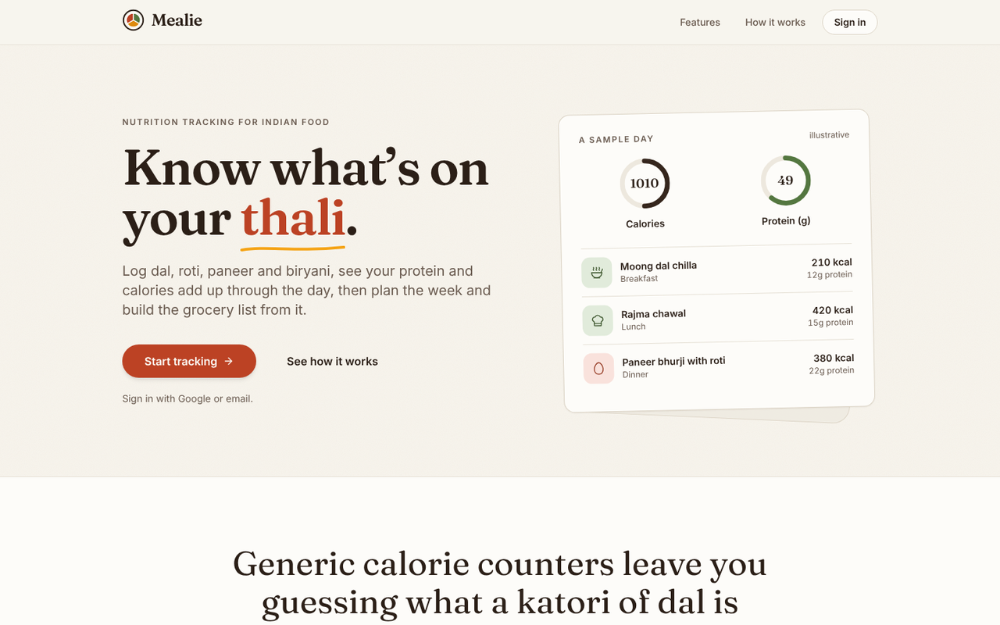
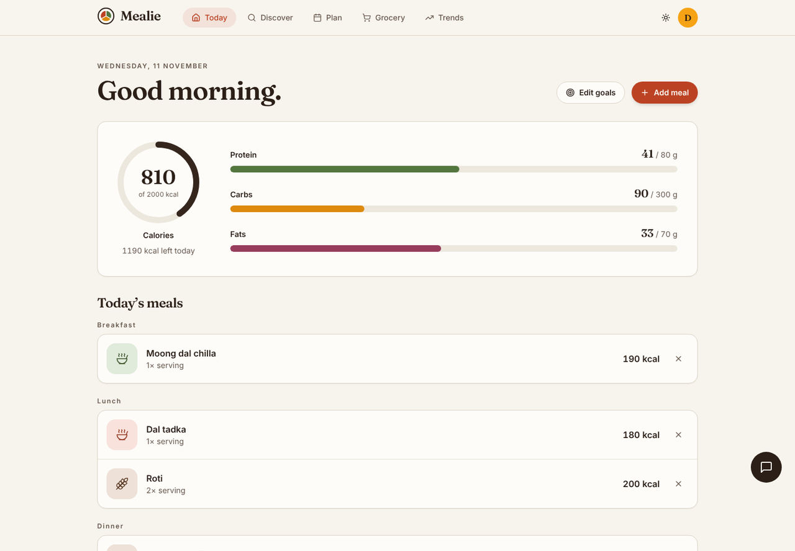
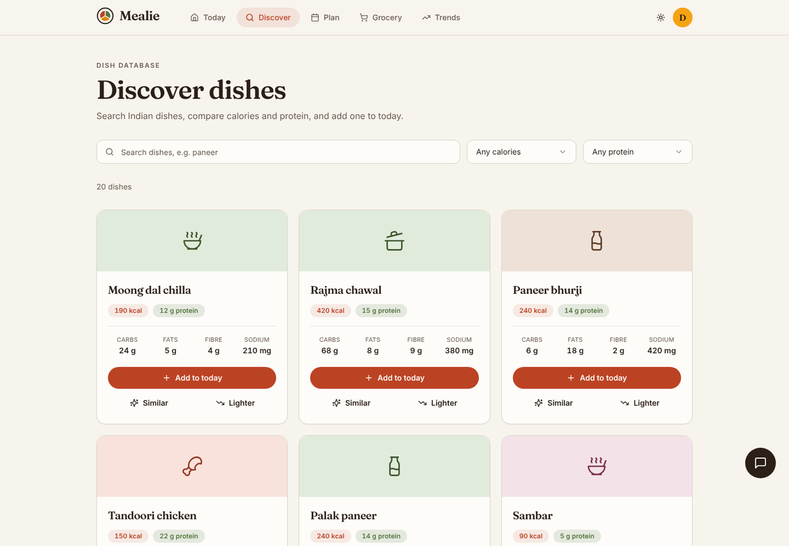
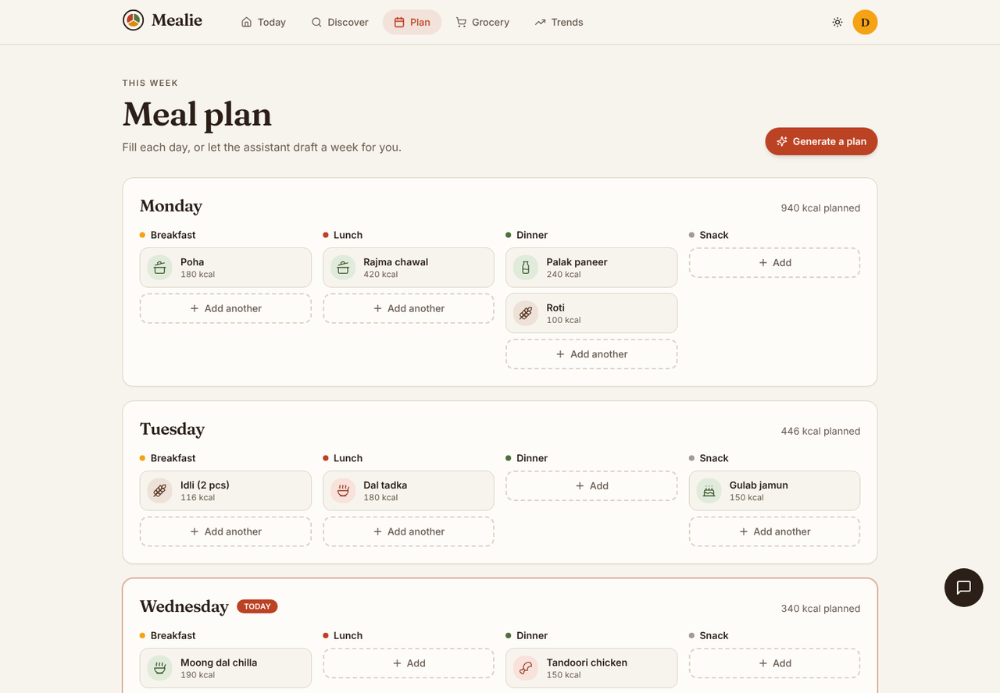
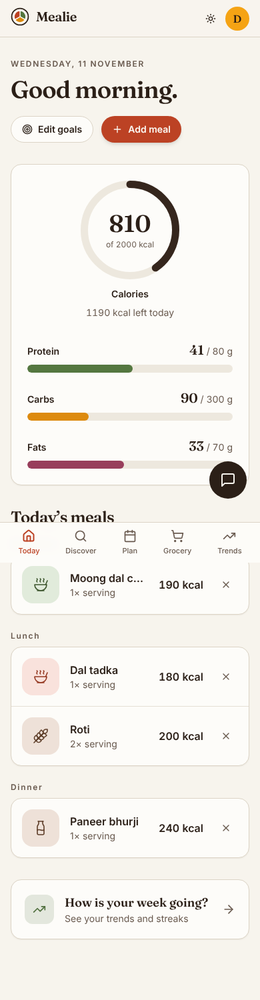

# Mealie

Nutrition tracking built around Indian food. Log dal, roti, paneer and biryani, watch calories and protein add up through the day, then plan the week and turn the plan into a grocery list.



## What it does

- **Today**: a calorie ring plus protein, carbs and fats against your own daily goals, with meals grouped by breakfast, lunch, dinner and snacks.
- **Discover**: browse a database of Indian dishes, filter by calories and protein, add one to today, or ask for a similar or lighter alternative.
- **Plan**: a seven-day meal plan with a running calorie total per day.
- **Grocery**: a checklist generated from the plan, grouped by category.
- **Trends**: a daily or weekly view of calories and macros, with bronze-to-gold tiers for how close you stayed to your calorie, protein and fibre goals.
- **Assistant**: a chat that suggests meal plans, swaps and recipes, running through a Supabase edge function.
- Light and dark themes, a guided first-run tour, and a layout that works from phone to desktop.

| Today | Discover |
| --- | --- |
|  |  |

| Plan | On a phone |
| --- | --- |
|  |  |

The screenshots use sample data.

## Tech stack

- React 18, TypeScript, Vite
- Tailwind CSS with shadcn/ui (Radix) components, design tokens in `src/index.css`
- Fraunces and Inter, bundled through `@fontsource-variable`
- Supabase: Postgres, auth (email and Google), row-level security, and one edge function
- React Router, TanStack Query, Recharts

## Run it locally

You need Node 18+ and a Supabase project.

```bash
git clone https://github.com/NavdeepSingh0/Mealie.git
cd Mealie
npm install
cp .env.example .env.local   # then fill in your Supabase values
npm run dev
```

The app runs at http://localhost:8080 (or the port Vite prints).

### Supabase setup

1. Create a project and run the SQL files in `supabase/migrations/` in order. They create the dish table, user profiles, logged meals and grocery lists, with row-level security.
2. Load your dish data into `nutrition_info`.
3. In Authentication, enable email sign-in and, if you want it, Google.
4. For the assistant, deploy the edge function and set its secret:

   ```bash
   supabase functions deploy ai-nutrition-chat
   supabase secrets set LOVABLE_API_KEY=your-key
   ```

   The function calls an OpenAI-compatible gateway with `google/gemini-2.5-flash`. Edit `supabase/functions/ai-nutrition-chat/index.ts` to point it at a different provider.

### Scripts

| Command | What it does |
| --- | --- |
| `npm run dev` | Start the dev server |
| `npm run build` | Production build into `dist/` |
| `npm run preview` | Serve the production build locally |
| `npm run lint` | Run ESLint |

## Deploying

It is a static single-page app. `vercel.json` already rewrites every route to `index.html`, so Vercel works with no extra setup beyond the three `VITE_SUPABASE_*` environment variables.

## Project layout

```
src/
  pages/          Landing, Auth, Dashboard, Discover, MealPlan, GroceryList, Analytics, AIChat
  components/     Navigation, Logo, MealThumb, dialogs, onboarding, ui/ (shadcn)
  integrations/   Supabase client and generated types
supabase/
  migrations/     Database schema
  functions/      ai-nutrition-chat edge function
```

Dishes in the database have no photos, so each dish gets an icon tile chosen from its name (a bowl for dal, a pot for biryani, and so on).

## Author

Built by [Navdeep Singh Dhunna](https://github.com/NavdeepSingh0).
